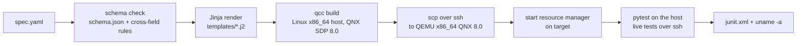

# Architecture

`resmgr-kit` is a host tool. It never runs on the QNX target; it produces QNX 8.0 software and tests it there.

A bad spec stops at the schema check with exit 2 and an error that names the field (for example `state[1] (rate_hz).max`). Only `test` goes past the render step; `gen` stops after it.

## Components

| Part | File | Job |
|---|---|---|
| CLI | [cli.py](src/resmgr_kit/cli.py), [__main__.py](src/resmgr_kit/__main__.py) | `gen` and `test` sub-commands |
| Spec loader and checks | [spec.py](src/resmgr_kit/spec.py), [schema.json](src/resmgr_kit/schema.json) | YAML safe load, JSON schema, cross-field rules |
| Renderer | [render.py](src/resmgr_kit/render.py) | Fills the templates, writes the output folder |
| Runner | [runner.py](src/resmgr_kit/runner.py) | Build, start or reuse the target, copy over ssh, run pytest, write JUnit |
| Resource manager | [resmgr.c.j2](src/resmgr_kit/templates/resmgr.c.j2) | `dispatch_create`, `resmgr_attach`, iofunc handlers, devctl table, pulse timer, thread pool, `MsgDeliverEvent` notify |
| Shared header | [header.h.j2](src/resmgr_kit/templates/header.h.j2) | devctl codes and structs shared with the client |
| Client | [client.c.j2](src/resmgr_kit/templates/client.c.j2) | Small test client for the generated `/dev` path |
| Build files | [Makefile.j2](src/resmgr_kit/templates/Makefile.j2), [build.j2](src/resmgr_kit/templates/build.j2) | `qcc` Makefile and an image build-file fragment |
| Security policy | [secpol.j2](src/resmgr_kit/templates/secpol.j2) | Type, `allow_attach`, abilities (see [TROUBLESHOOTING](docs/TROUBLESHOOTING.md)) |
| Tests | [test.py.j2](src/resmgr_kit/templates/test.py.j2) | pytest file that drives the live device over ssh |
| Host tests | [tests/host](tests/host) | 37 tests that need no QNX toolchain |
| Examples | [vsensor](examples/vsensor/vsensor.yaml), [estop](examples/estop/estop.yaml) | Two specs used for the live runs |

## Where each step runs

- Spec check, render and pytest run on the developer machine (any OS with Python 3.11+).
- `qcc` runs in a Linux x86_64 host, because the QNX SDP host tools ship for Linux x86_64 and Windows. On macOS that host is a VM or container; see [HOST-SETUP](docs/HOST-SETUP.md).
- The target is QNX 8.0 x86_64 under QEMU, reached by ssh. The runner reuses a target that already answers and runs `target_start` from the config otherwise.
- Config comes only from `~/.config/resmgr-kit/config.toml`, environment variables or an explicit `--config`, never from the current folder, because its commands run in a shell.
